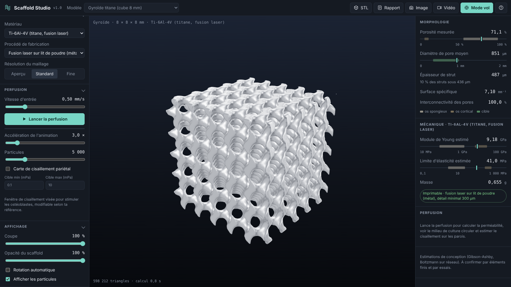

# Scaffold Studio

[Version française](README.md)

Design, measurement and simulated perfusion of porous scaffolds for bone tissue engineering.

Scaffold Studio builds porous architectures from triply periodic minimal surfaces, strut lattices and Voronoi foams, computes their morphological and mechanical properties live, then simulates culture medium flow, oxygen transport, cell seeding and tissue growth through the pores. Everything runs in the browser, locally, with no compute server.

**Live demo:** https://emmanuel-creat.github.io/Scaffold-Studio/ (installable, works offline)



## The problem

Designing a bone scaffold means constantly trading off:

- enough porosity and large enough pores (roughly 300 to 900 µm) for cells to colonise the structure and for nutrients to flow;
- enough material to keep the stiffness close to bone and avoid stress shielding;
- walls thick enough to be manufactured by the chosen process;
- a fluid wall shear stress in the window that stimulates osteoblasts without detaching them.

These trade-offs usually require several heavy tools (CAD, meshing, CFD, FEA). Scaffold Studio brings them into a single real-time view.

## Features

| Area | What the application does |
| --- | --- |
| Geometry | 9 TPMS surfaces (gyroid, diamond, Schwarz P, I-WP, Neovius, Fischer-Koch S, F-RD, Split P, lidinoid), network or sheet mode, strut lattices (cubic, BCC, FCC, octet), trabecular Voronoi foam, smooth blend between two surfaces, anisotropic and rotated cells, fit to whole cells, automatic removal of detached fragments |
| Part shape | Block, cylinder, interbody cage with rounded corners, acetabular cup, central graft hole, solid skin, import of any STL shape (segmented bone defect, implant) |
| Gradients | Axial, radial, spherical, from the surface (dense shell, porous core), multipoint height profile, density map from an image, on porosity and cell size |
| Added or removed shapes | Block, cylinder or sphere added as solid (fixation plate) or cut from the network (channel, screw seat) |
| Inverse design | Porosity computed to reach a target strut thickness or a target stiffness |
| Morphology | Measured porosity, pore diameter and strut thickness by inscribed spheres, specific surface, interconnectivity |
| Mechanics | Young's modulus and yield strength (Gibson-Ashby) for 10 materials plus a custom one, compared with bone ranges, mass |
| Advanced analyses | Pore and strut histograms, percolation (throat) diameter, geometric and hydraulic tortuosity, simulated porosimetry, porosity profile along the height, closed voids and detached islands, concave, saddle and cell accessible surface fractions |
| Surface maps | Local thickness, local pore size, mean curvature, Gaussian curvature, overhangs, wall shear stress, von Mises |
| Finite elements | Periodic voxel FE homogenisation of the unit cell: stiffness tensor, Ex, Ey, Ez, shear moduli, Zener anisotropy, 3D modulus anisotropy surface, Emax / Emin, von Mises map, stress concentration, Gibson-Ashby fit for the chosen surface, modulus of a graded specimen |
| Simulated tests | Model compression curve with ISO 13314 quantities, fatigue endurance, strut slenderness and buckling |
| Resorption | Mass and stiffness over 36 months for magnesium, zinc, β-TCP, PCL and PLA |
| Manufacturing | Minimum feature check per process, Taubin smoothing, layer preview, overhangs, build plate nesting, time and cost estimate |
| Perfusion | D3Q19 TRT lattice Boltzmann on GPU (WebGPU) or CPU, Darcy permeability, permeability tensor, pressure drop, tracer particles, streamlines, culture medium, serum or blood (Carreau) |
| Biology | Dissolved oxygen under perfusion and static culture, hypoxic zones, animated perfusion seeding, curvature driven tissue growth day by day |
| Studio | 1:1, 4:5, 9:16 and 16:9 formats, realistic rendering, depth of field, powder grain, title and scale bar overlays, 4K stills, recorded camera shots (orbit, crane, dive, cut reveal, key views), frame by frame MP4 at 60 fps in Full HD or 4K |
| Project | Undo and redo, version history with thumbnails, project save and load, shareable link, fast preview then full resolution, French or English interface |
| Comfort | Command palette (Ctrl+K) reaching every setting, guided tour, phone tabs, full keyboard use, screen reader labels, reduced motion respected |
| Exports | STL and 3MF, VTK surface with maps (ParaView), Abaqus voxel mesh with a compression step, VTK velocity field, CSV, printable HTML design report, PNG, MP4 or WebM |

## Run locally

Requires [Node.js](https://nodejs.org) 18 or later.

```bash
npm install
npm run dev        # http://localhost:5173
npm test           # unit and regression tests (Vitest)
npm run typecheck  # type checking of the computational core
npm run e2e        # end to end tests in Chromium (Playwright)
npm run bench      # timings of the main computations
npm run build      # production build in dist/
```

GitHub Actions runs type checking, unit and regression tests, the benchmark (table in the job summary, warning above a 50 % slowdown) and the end to end tests, whose screenshots are kept for 14 days.

## Shortcuts

| Key | Action |
| --- | --- |
| F | Fly through the pores |
| H | Hide the interface (capture mode) |
| R | Start or stop video recording |
| P | Screenshot |
| Space | Start or stop perfusion |
| Esc | Leave fly mode, stop a shot |
| Ctrl+Z, Ctrl+Y | Undo, redo |
| Ctrl+S | Save project |
| Ctrl+K or / | Search a command or setting |

## Methods

The full methods page is [docs/METHODS.md](docs/METHODS.md) (French: [docs/METHODES.md](docs/METHODES.md)), the specification is [docs/SPECIFICATION.md](docs/SPECIFICATION.md).

- **Geometry:** each surface threshold is computed by quantile on a unit cell to hit the target porosity exactly; the isosurface is meshed with surface nets (closed, oriented mesh).
- **Lattices and Voronoi:** distance to the cell struts, folded by symmetry into one octant; Voronoi uses F3 − F1 on eight jittered seeds per cell.
- **Morphology:** exact Euclidean distance transform (Felzenszwalb and Huttenlocher), diameters at local maxima.
- **Finite elements:** 8 node hexahedra on the voxelised cell (24³), periodic boundary conditions, six unit strains, matrix free preconditioned conjugate gradient.
- **Perfusion:** D3Q19 lattice Boltzmann with two relaxation times (magic parameter 3/16), halfway bounce back, body force or imposed pressure, Darcy permeability.
- **Oxygen:** steady advection diffusion with Michaelis-Menten consumption at the walls, upwind scheme, over-relaxed Gauss-Seidel.
- **Seeding:** cells advected by the flow and settling at 9 µm/s, attachment probability at wall contact.
- **Tissue growth:** curvature driven model (Rumpler 2008, Bidan 2012).
- **Curvatures and anisotropy:** mean and Gaussian curvature from the gradient and Hessian of the implicit field (Goldman 2005); directional modulus 1/E(n) = a · S · a from the homogenised compliance.

## Validation

See [docs/VALIDATION.md](docs/VALIDATION.md) for the comparison with published measurements, and the automatic tests listed in the French README (Poiseuille flow within 1 %, Sangani and Acrivos sphere array within 0.4 %, GPU and CPU solvers within 0.004 %, exact Voigt bound on a laminate, isotropic tensor recovered to 10⁻⁶, and more).

Mechanical and shear values are design estimates. They guide an architecture choice and must be confirmed by testing.

## Teaching

A guided practical for bioengineering master students is in [docs/TP_GUIDE.md](docs/TP_GUIDE.md) (French).

## Author

BAILLY emmanuel, master student in Bioengineering of Tissues and Implants (Aix-Marseille Université).

MIT licence. To cite this software, see [CITATION.cff](CITATION.cff).
