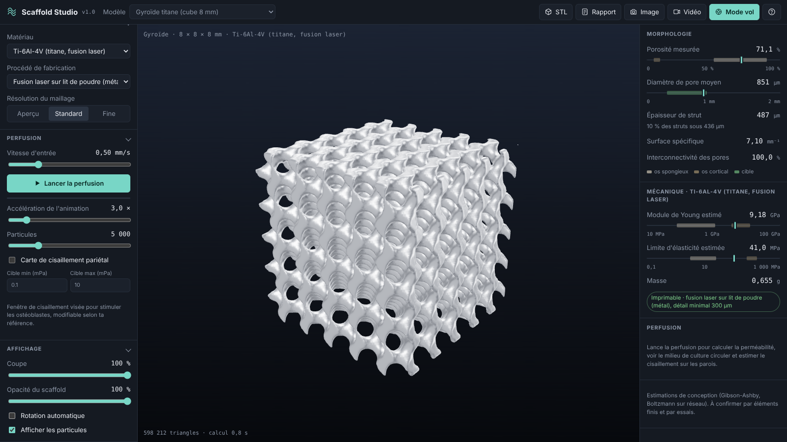
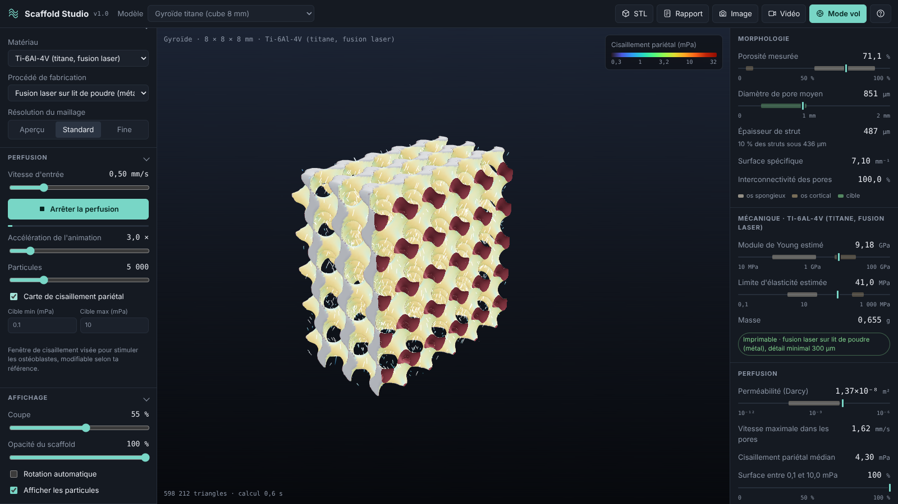
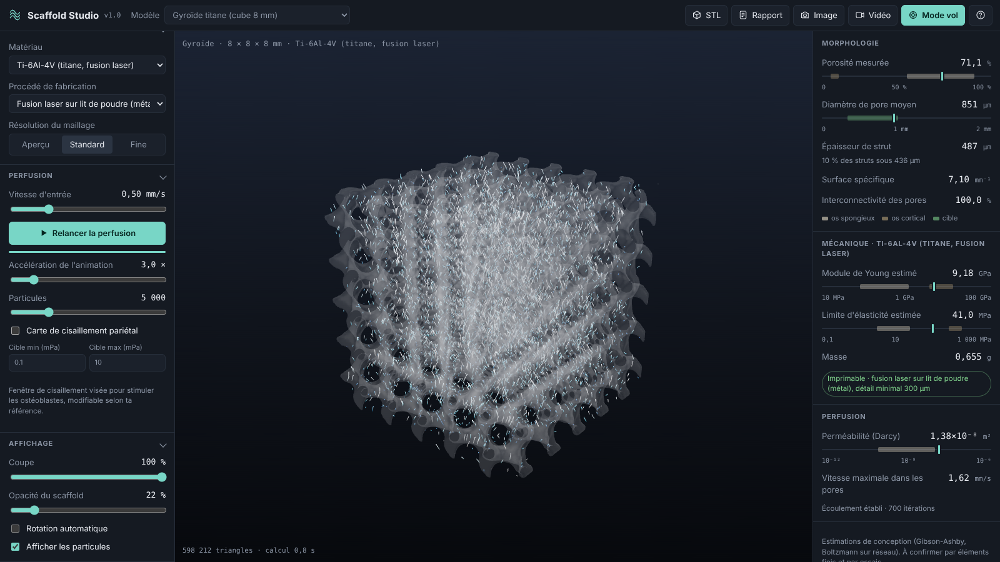
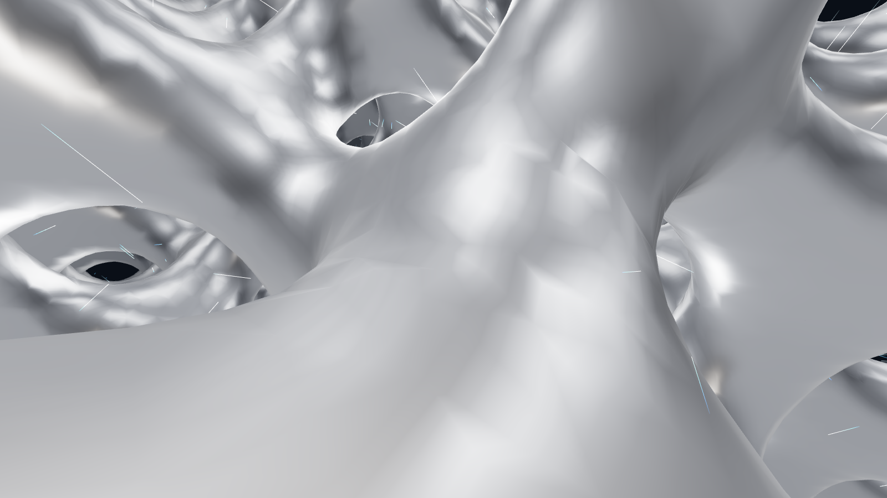
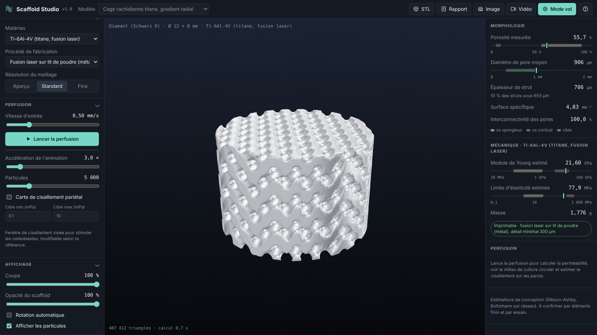

# Scaffold Studio

Conception, mesure et perfusion simulée de scaffolds poreux pour l'ingénierie tissulaire osseuse.

Scaffold Studio génère des architectures poreuses à partir de surfaces minimales triplement périodiques (gyroïde, diamant, Schwarz P, I-WP, Neovius), calcule en direct leurs propriétés morphologiques et mécaniques, puis simule la circulation du milieu de culture à travers les pores. Le tout tourne dans le navigateur, en local, sans serveur de calcul.

**Démo en ligne :** https://emmanuel-creat.github.io/Scaffold-Studio/



## Le problème

Concevoir un scaffold osseux, c'est arbitrer en permanence :

- assez de porosité et des pores assez larges (de l'ordre de 300 à 900 µm) pour que les cellules colonisent la structure et que les nutriments circulent ;
- assez de matière pour que la rigidité reste proche de celle de l'os et éviter le phénomène de stress shielding ;
- des parois assez épaisses pour être fabriquées par le procédé choisi ;
- un cisaillement du fluide sur les parois dans une fenêtre qui stimule les ostéoblastes sans les arracher.

Ces compromis se calculent d'habitude dans plusieurs logiciels lourds (CAO, maillage, mécanique des fluides). Scaffold Studio les réunit dans une seule vue, en temps réel.

## Fonctions

| Domaine | Ce que fait l'application |
| --- | --- |
| Géométrie | 5 surfaces TPMS, mode réseau (struts) ou feuillet (paroi), taille de cellule de 0,6 à 5 mm, porosité visée de 30 à 92 %, éprouvette en pavé ou en cylindre |
| Gradients | Porosité constante, gradient axial (base vers sommet) ou radial (coeur spongieux vers périphérie corticale) |
| Morphologie | Porosité mesurée sur le maillage, diamètre de pore et épaisseur de strut par sphère inscrite, surface spécifique, interconnectivité des pores |
| Mécanique | Module de Young et limite d'élasticité estimés (Gibson-Ashby) pour 6 matériaux, comparés aux plages de l'os spongieux et cortical, masse de la pièce |
| Fabrication | Vérification de l'épaisseur minimale selon le procédé (stéréolithographie, fusion laser sur lit de poudre, dépôt de fil) |
| Perfusion | Écoulement de Stokes par méthode de Boltzmann sur réseau (D3Q19), perméabilité de Darcy, particules traçantes animées |
| Cisaillement | Carte de cisaillement pariétal sur toute la surface et part de la surface dans la fenêtre cible |
| Visualisation | Vue en coupe, transparence, rotation, mode vol à travers les pores en suivant une ligne de courant |
| Exports | Maillage STL (millimètres) prêt pour l'impression 3D, rapport CSV des mesures, capture PNG, enregistrement vidéo WebM |







## Modèles fournis

- Gyroïde titane (cube 8 mm)
- Cage rachidienne titane avec gradient radial
- Substitut osseux résorbable en PCL
- Os trabéculaire bio-inspiré en hydroxyapatite avec gradient axial
- Bouchon en tantale Schwarz P
- Implant PEEK Neovius



## Lancer en local

Prérequis : [Node.js](https://nodejs.org) 18 ou plus.

Sous Windows, double-cliquer sur `Lancer-Scaffold-Studio.bat`. Sinon :

```bash
npm install
npm run dev
```

L'application s'ouvre sur http://localhost:5173. Une fois installée, elle fonctionne sans connexion.

Autres commandes :

```bash
npm test          # tests unitaires (maillage, mesures, solveur)
npm run build     # version de production dans dist/
```

## Raccourcis

| Touche | Action |
| --- | --- |
| F | Mode vol à travers les pores |
| H | Masquer l'interface (mode capture) |
| R | Démarrer ou arrêter l'enregistrement vidéo |
| P | Capture d'image |
| Espace | Lancer ou arrêter la perfusion |
| Échap | Quitter le mode vol |

## Tourner une vidéo

1. Lancer la perfusion et attendre « Écoulement établi ».
2. Régler l'opacité vers 20 % pour voir les particules, ou activer la carte de cisaillement.
3. Appuyer sur H pour masquer l'interface, puis R pour enregistrer.
4. Appuyer sur F pour le vol à travers les pores (environ 26 secondes de traversée).
5. R pour arrêter : la vidéo est téléchargée en WebM.

## Méthodes et validation

Les méthodes sont détaillées dans le [cahier des charges](docs/CAHIER_DES_CHARGES.md). En résumé :

- **Géométrie :** le seuil de chaque surface est calculé par quantile sur une cellule unité pour atteindre exactement la porosité visée, puis l'isosurface est maillée par surface nets (maillage fermé et orienté).
- **Morphologie :** transformée de distance euclidienne exacte (Felzenszwalb et Huttenlocher), diamètres pris aux maxima locaux.
- **Mécanique :** loi de Gibson-Ashby, E = C · Es · ρ*ⁿ avec n = 2 en réseau et 1,5 en feuillet.
- **Perfusion :** Boltzmann sur réseau D3Q19, collision BGK, rebond à mi-chemin sur les parois, force volumique équivalente à un gradient de pression, perméabilité par la loi de Darcy. Sans gradient, le calcul porte sur une cellule périodique, ce qui donne la perméabilité du réseau infini.

Tests automatiques :

| Test | Résultat |
| --- | --- |
| Écoulement de Poiseuille entre deux plaques | écart de 0,3 % avec la solution analytique |
| Volume du maillage par rapport à la porosité visée | écart inférieur à 3 points sur les 10 combinaisons surface et mode |
| Transformée de distance | distances exactes sur un cas de référence |
| Interconnectivité d'un gyroïde | 100 % |

Les valeurs mécaniques et de cisaillement sont des estimations de conception. Elles orientent un choix d'architecture et doivent être confirmées par éléments finis et par essais.

## Structure du code

```
src/
  tpms.js          surfaces, seuils de porosité, champ implicite
  mesher.js        maillage surface nets, volume et aire
  metrics.js       mesures morphologiques et mécaniques, matériaux
  lbm.js           solveur de Boltzmann sur réseau D3Q19
  geo.worker.js    calcul géométrie et mesures hors du fil principal
  flow.worker.js   calcul de perfusion hors du fil principal
  flow.js          particules, cisaillement, trajectoire de vol
  main.js          scène 3D, exports, raccourcis
  ui.js, panel.js  panneaux de paramètres et de mesures
tests/             tests unitaires (Vitest)
```

## Auteur

BAILLY emmanuel, étudiant en master Bioingénierie des tissus et des implants (Aix-Marseille Université).

Licence MIT.
